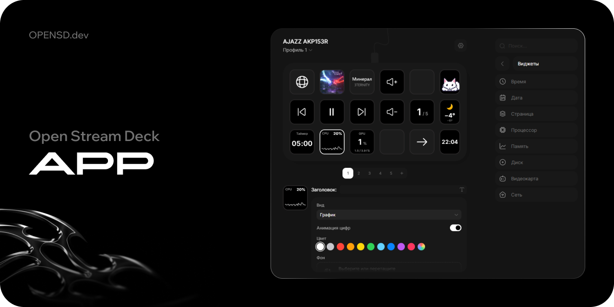

# Open Stream Deck

Открытое приложение для макропанели AJAZZ AKP153R: клавиши, страницы, профили, виджеты, плагины и обновление прошивки. Работает с деками, на которых стоит [прошивка Open Stream Deck](https://github.com/Open-Stream-Deck/Firmware-AjazzAKP153R), и само устанавливает её поверх стоковой.

[](https://github.com/Open-Stream-Deck/Open-Stream-Deck-App/actions/workflows/ci.yml)
[](https://wiki.opensd.dev)

## Установка

Работает на Windows 10 и 11, macOS 11 и новее (Apple Silicon и Intel) и Linux x64. Установщики лежат в [последнем релизе](https://github.com/Open-Stream-Deck/Open-Stream-Deck-App/releases/latest): `OpenStreamDeck-win-Setup.exe` для Windows, `OpenStreamDeck-osx-Setup.pkg` для macOS, `OpenStreamDeck.AppImage` для Linux. Установка, обновление и удаление работают через [Velopack](https://velopack.io), пошагово для каждой системы: [docs/INSTALL.md](docs/INSTALL.md). При каждом запуске приложение сначала проверяет обновление в маленьком окне и ставит его, если оно есть. Что менялось между версиями: [CHANGELOG.md](CHANGELOG.md).

Со стоковой прошивкой приложение деку видит, но управлять ею не может. Скачайте BIN-файл из [релизов прошивки](https://github.com/Open-Stream-Deck/Firmware-AjazzAKP153R/releases), откройте «Настройки», «Прошивка», нажмите «Выбрать файл» и затем «Установить». Когда приложение попросит, переподключите USB.

## Возможности

- 15 клавиш и три блока бокового экрана на странице, до 10 страниц, несколько профилей.
- Иконки, подписи с выбором шрифта и цвета, копирование и перенос клавиш и страниц.
- Встроенные действия: запуск программ, открытие сайтов, горячие клавиши, ввод текста, блокировка компьютера, управление воспроизведением и громкостью, переключение страниц и профилей.
- Виджеты: время, дата, таймер, обратный отсчёт, погода, загрузка процессора, памяти, диска, видеокарты и сети.
- Плагины Open Stream Deck SDK в формате `.opensd`.
- Вывод на деку без накопления задержки: всегда рисуется последнее состояние, плагины отправляют только изменившиеся области кнопок.
- Анимацию нажатия рисует приложение, на деку уходят только изменившиеся полосы кнопки.
- Работа в фоне: значок в трее, автозапуск, один экземпляр. Дека работает и при закрытом окне.
- Страницы нескольких профилей кэшируются в видеопамяти деки, переключение между недавними профилями мгновенное.
- Проверка канала до деки: «Настройки», «Прошивка», «Канал до деки».
- Интерфейс на русском, английском и китайском, светлая и тёмная темы.
- Окно запуска с проверкой и установкой обновлений, главное окно появляется уже отрисованным.

## Плагины

Плагины пишутся на Rust, JavaScript, TypeScript или любом языке, который собирается в WebAssembly. Каждый работает в изолированном воркере WebView без доступа к файлам, процессам и сети, кроме того, что пользователь разрешил явно. Установка: «Настройки», «Плагины», «Установить из файла».

Для разработки включите там же «Режим разработчика» и запустите `opensd dev` в проекте плагина. Инструменты и документация: [Open Stream Deck SDK](https://github.com/Open-Stream-Deck/Open-Stream-Deck-SDK), [wiki.opensd.dev/docs/sdk](https://wiki.opensd.dev/docs/sdk).

## Сборка

Нужны Node.js 24, pnpm 12, Rust stable и [зависимости Tauri](https://tauri.app/start/prerequisites/) для вашей системы. На Linux ещё `libudev-dev` (Debian, Ubuntu) или `systemd-devel` (Fedora).

```bash
pnpm install
pnpm tauri dev
```

Установщики собирает [vpk](https://docs.velopack.io) из Velopack, ему нужен .NET 8 SDK. На Windows приложение собирается без бандла и упаковывается из `src-tauri/target/release`, на macOS из `.app`, на Linux из AppDir, который делает Tauri. Пример для Windows:

```bash
pnpm tauri build --no-bundle
dotnet tool update -g vpk --version 1.2.161
vpk pack --packId OpenStreamDeck --packVersion 1.0.0 --packDir src-tauri/target/release --mainExe open-stream-deck.exe --packTitle "Open Stream Deck" --icon src-tauri/icons/icon.ico --splashImage src-tauri/icons/splash.png --splashProgressColor None --framework webview2 --noPortable
```

Окно запуска ищет обновления в последнем релизе на GitHub. Чтобы проверить его на своих пакетах, раздайте папку `Releases` по HTTP и укажите её адрес в `OSD_UPDATE_FEED`.

Перед отправкой изменений:

```bash
pnpm build
cd src-tauri
cargo fmt --check
cargo clippy --all-targets -- -D warnings
cargo test
```

Интерфейс на Preact лежит в `src`, окно запуска в `src/splash`, бэкенд на Tauri в `src-tauri`: связь с декой по USB HID (`deck.rs`), замер канала (`bench.rs`), установка прошивки (`firmware.rs`), окно запуска и обновление (`launcher.rs`), встроенные действия (`actions.rs`), хост плагинов (`plugins`). Протокол деки описан в [документации прошивки](https://wiki.opensd.dev/docs/firmware/protocol). Замер канала без запущенного приложения: `cargo run --release --example bench` в `src-tauri`.

## Релиз

Версия задаётся в `package.json` и `src-tauri/Cargo.toml`, а в `CHANGELOG.md` должен быть раздел с этой версией. Тег `vX.Y.Z` создаёт черновик релиза с текстом из CHANGELOG, собирает приложение на Windows, macOS и Linux, упаковывает его через vpk с дельтами от прошлой версии, загружает установщики, пакеты и `releases.{win,osx,linux}.json` и публикует релиз, когда все сборки прошли. Если хоть одна упала, релиз остаётся черновиком.

## Лицензия

Исходники доступны по [Open Stream Deck Noncommercial License 1.0](LICENSE). 

Некоммерческое использование, изменение и распространение разрешены с обязательным указанием автора и сохранением лицензии. 

Коммерческое использование, включая продажу устройств с этой прошивкой, требует отдельной письменной лицензии от автора: [ceo@lisik.dev](mailto:ceo@lisik.dev).
